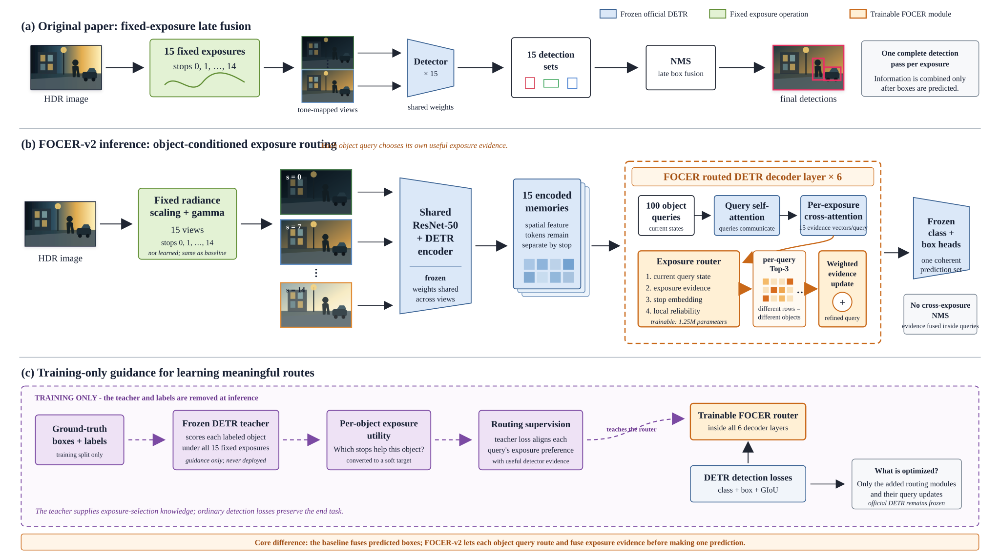

# FOCER-v2

**Factorized Object-Conditioned Exposure Routing for HDR Object Detection**

FOCER-v2 extends a frozen DETR–ResNet-50 detector with query-level exposure
routing. Given one HDR image, it renders 15 fixed exposure branches. Instead of
running 15 complete detectors and merging their final boxes, every DETR object
query retrieves evidence from each exposure and selects its own top three
branches inside every decoder layer. The model produces one coherent DETR
prediction set without cross-exposure NMS.



Editable vector and export-ready versions: [SVG](assets/focer_v2_paper_architecture.svg),
[PDF](assets/focer_v2_paper_architecture.pdf), and
[PNG](assets/focer_v2_paper_architecture.png). The earlier compact technical
diagram remains available at [assets/focer_v2_architecture.svg](assets/focer_v2_architecture.svg).

## Why object-conditioned routing?

Objects in the same HDR scene can require different exposures. A person in a
dark doorway may need a bright rendering, while a nearby headlight or sunlit
vehicle may be clearer at a low exposure. A single image-level exposure choice
cannot express both preferences.

FOCER-v2 keeps exposure memories separate and lets every object query decide
which evidence is useful for the object it is currently constructing:

```text
HDR image -> fixed stops 0..14 -> shared frozen ResNet-50 + DETR encoder
          -> 15 separate memories
          -> per-query evidence from every exposure
          -> object-conditioned top-3 routing in each of 6 decoder layers
          -> frozen DETR class/box heads
          -> one 100-query prediction set
```

The router uses four signals for every query/exposure pair:

1. the current object-query state;
2. evidence retrieved from that exposure;
3. a continuous embedding of the numerical exposure stop;
4. query-local radiometric reliability, which discounts very dark or clipped
   evidence in the spatial region attended by that query.

There is no learned exposure generator and no global fused feature map. The 15
stops are fixed at `0, 1, ..., 14`; only query-level evidence is combined.

## Training-only teacher

The untouched official DETR-R50 acts as an offline teacher. For every labelled
training object, it evaluates all 15 exposures. Correct-class confidence and
box quality are converted into a soft exposure-utility target. The router learns
to predict these per-object exposure preferences while ordinary DETR detection
losses ensure that the routed evidence improves classification and localization.

The teacher, teacher cache, and ground-truth labels are absent at inference.
Inference uses only the HDR image, the frozen detector, and the trained router.

## What is trained?

Only the newly introduced routing components are optimized:

- six decoder layers' `route_query` projections;
- six decoder layers' `route_evidence` projections;
- six decoder layers' `route_stop` projections;
- one shared continuous stop encoder.

This is **1,251,328 trainable parameters in 34 tensors**. ResNet-50, the DETR
encoder, object-query embeddings, original decoder attention/FFN/norm modules,
class head, and box head remain frozen and in evaluation mode. The audited
checkpoint retained all 458 inherited DETR tensors bit-for-bit.

## Result

The controlled same-source experiment used the 1,596-image HDR4RTT portion of
HDRDCL and its HDRDCL annotations. The immutable protocol contained 1,264
training, 168 validation, 150 test, and 14 guard images. Epoch count was selected
on validation mAP, followed by a fresh 11-epoch fit on train+validation and one
final test evaluation.

| Method | Person AP | Bicycle AP | Car AP | Truck AP | Mean AP |
|---|---:|---:|---:|---:|---:|
| Paper fixed 15-exposure baseline | 43.09 | 33.32 | 49.39 | 40.06 | **41.46** |
| FOCER-v2 | 52.44 | 36.90 | 52.72 | 58.27 | **50.08** |
| Difference | +9.35 | +3.59 | +3.33 | +18.20 | **+8.62** |

The saved predictions were independently recomputed with `pycocotools`. The
full machine-readable result is in
[`results/FINAL_TEST_COMPARISON.json`](results/FINAL_TEST_COMPARISON.json).

### Scientific scope

This is a promising **same-source** result, not yet a claim of generalization to
unseen cameras or scenes. The split contains no byte-identical image across
train/validation/test, but HDR4RTT includes temporally or visually related
scenes. A scene-disjoint split, multiple seeds, uncertainty estimates, and
teacher/no-teacher/global-routing ablations remain important next steps. See
[`docs/AUDIT_REPORT.md`](docs/AUDIT_REPORT.md) for the complete audit.

## Repository structure

```text
FOCER-v2/
├── models/focer.py             FOCER-v2 renderer and routed decoder
├── focer_main.py               teacher cache, training, fitting, evaluation
├── hdr4rtt_experiment.py       audited split/select/refit/test protocol
├── run_clean.py                end-to-end test-excluding experiment runner
├── split_manifest.py           immutable HDR4RTT split definition
├── routing_oracle.py           branch-utility analysis
├── datasets/                   HDR/EXR and COCO data loaders
├── baseline/                   fixed-exposure paper baseline evaluation
├── tests/                      unit and protocol regression tests
├── scripts/                    cache utilities
├── assets/                     architecture figure
├── results/                    small result/configuration records
├── DESIGN.md                   architecture and ablation contract
└── HDR4RTT_EXPERIMENT.md       experimental protocol
```

Datasets, teacher caches, detector weights, trained checkpoints, and run outputs
are intentionally excluded from Git because they are large and may have separate
redistribution terms.

## Requirements

- Python 3.10 or newer
- A matching PyTorch/torchvision installation
- CUDA GPU recommended; A100 recommended for full training
- Packages listed in `requirements.txt`

Install PyTorch and torchvision for your CUDA version first, then:

```bash
python -m pip install -r requirements.txt
```

Run the test suite:

```bash
python -m unittest discover -s tests -v
```

The audited source passes all 15 tests.

## Data and weights

Prepare the following local layout. These paths are ignored by Git:

```text
FOCER-v2/
├── data/
│   ├── HDR4RTT/detection/              1,596 EXR images
│   └── annotations/HDRDCL_TRAIN.json   audited COCO master annotation
└── weights/
    └── detr-r50-e632da11.pth           official DETR-R50 checkpoint
```

The annotation `file_name` values are expected to point to
`HDR4RTT/detection/<image>.exr` relative to `data/`. Per-image HDR scales are
stored in the annotation metadata.

Expected immutable SHA-256 values for the audited experiment:

```text
HDRDCL_TRAIN.json:
47ba1074081ad3b26ed359f1fed2baba59b0779c31a8b860c477e26fb85b38b5

detr-r50-e632da11.pth:
e632da11ec76ae67bac2f8579fbed3724e08dead7d200ca13e019b197784eadc
```

The HDR images and annotations are not included. Confirm the HDR4RTT/HDRDCL
terms before redistributing them. The trained router checkpoint is also omitted
because it exceeds GitHub's normal file limit; publish large checkpoints through
a release or an external research-artifact store if redistribution is allowed.

## Reproduce the clean experiment

With the layout above:

```bash
python run_clean.py --device cuda --amp
```

The runner performs the complete protocol:

1. verifies the master annotation and official detector hashes;
2. regenerates the immutable 1,264/168/150/14 split;
3. builds teacher supervision from train+validation only;
4. derives exact train, validation, and train+validation caches;
5. trains for up to 20 epochs and selects by validation four-category COCO mAP;
6. freshly initializes the router and refits on train+validation for the
   selected epoch count;
7. evaluates FOCER-v2 and the paper fixed-exposure baseline on the same 150
   test images;
8. writes `FINAL_TEST_COMPARISON.json`.

Use a new output directory for an independent run:

```bash
python run_clean.py \
  --run-root runs/focer_v2_seed123 \
  --seed 123 --device cuda --amp
```

Pass `--allow-resume` only when continuing the same interrupted run.

## Methodological notes

- Training the new router is part of the proposed method; the baseline has no
  equivalent routing parameters.
- Teacher supervision uses labelled training objects only. It is privileged
  training information, not inference-time computation.
- All 15 exposures still require shared backbone/encoder computation. FOCER-v2
  removes repeated prediction sets and late box fusion, not all multi-exposure
  feature-extraction cost.
- A positive result for the complete method does not by itself isolate the
  effects of object-conditioned routing, teacher guidance, radiometric
  reliability, and balanced sampling. `DESIGN.md` lists the required ablations.

## License

The code is released under the Apache License 2.0; see [`LICENSE`](LICENSE).
Dataset and pretrained-weight licenses are separate and are not granted by this
repository.

## Acknowledgements

FOCER-v2 builds on DETR and the original fixed-exposure HDR detection baseline.
Please cite the original projects and datasets when using this repository.
